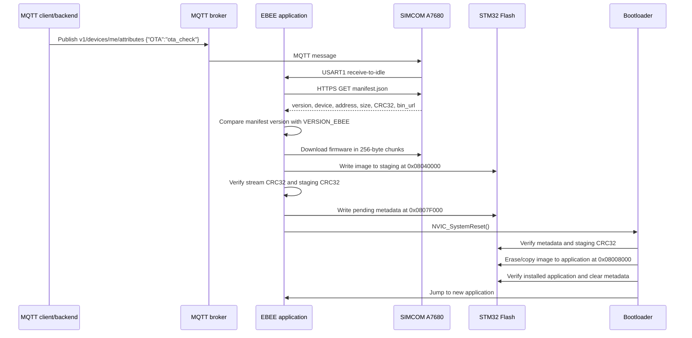

# OTA cho EBEE STM32F103RET6 qua SIMCOM A7680

## 1. Tổng quan

Luồng OTA của EBEE được chuyển từ dự án `wbee_hbee_v1`. Thiết bị nhận lệnh OTA qua MQTT, tải `manifest.json` và firmware qua HTTPS bằng SIMCOM, kiểm tra phiên bản và CRC32, sau đó lưu firmware vào vùng staging. Bootloader cài image đã xác minh vào vùng application rồi khởi động firmware mới.

OTA chỉ chạy khi modem đang ở trạng thái `Subscribed`. Trong khi OTA chạy, callback USART1 chuyển toàn bộ phản hồi modem vào bộ đệm riêng của OTA để dữ liệu nhị phân từ `AT+HTTPREAD` không bị xử lý như phản hồi MQTT thông thường.

## 2. Luồng hoạt động



Nếu phiên bản trên server không lớn hơn `VERSION_EBEE`, thiết bị ghi log `firmware is already current` và tiếp tục chạy firmware hiện tại. Nếu tải hoặc kiểm tra thất bại, application hiện tại không bị ghi đè.

## 3. Phân vùng Flash

STM32F103RET6 có 512 KB Flash, page size 2 KB.

| Vùng | Địa chỉ bắt đầu | Kích thước | Mục đích |
|---|---:|---:|---|
| Bootloader code | `0x08000000` | 30 KB | Provision config, kiểm tra metadata và cài firmware |
| Factory config | `0x08007800` | 2 KB | Serial number và MQTT credential theo thiết bị |
| OTA application | `0x08008000` | 224 KB | Firmware EBEE đang chạy |
| Staging | `0x08040000` | 252 KB | Firmware mới đang tải |
| OTA metadata | `0x0807F000` | 2 KB | Trạng thái pending, size và CRC32 |
| Reserved config | `0x0807F800` | 2 KB | Dành cho cấu hình lưu trong Flash |

Application bắt buộc được link tại `0x08008000`. Cả cấu hình Debug và Release trong `.cproject` đều dùng `STM32F103RETX_OTA_APP.ld` và define `OTA_APP_BUILD`; `system_stm32f1xx.c` vì vậy đặt vector table tại offset `0x8000`.

## 4. Cấu hình firmware

Các macro nằm trong `Core/Inc/config.h` và có thể override bằng `Core/Inc/config_local.h`:

```c
#define VERSION_EBEE "1.0.0"
#define OTA_ENABLE 1
#define OTA_MANIFEST_URL "https://raw.githubusercontent.com/kenhkythuat/ebee_vnpt_green/refs/heads/feature/connect_server_vnpt/ota/manifest.json"
#define OTA_DEVICE_ID "ebee-stm32f103ret6"
```

`OTA_MANIFEST_URL` và mọi `bin_url` phải truy cập được trực tiếp từ SIMCOM mà không cần đăng nhập, cookie hoặc token trình duyệt. Repository GitHub phải public; nếu chuyển sang private, hãy dùng object storage/public HTTPS endpoint khác và override `OTA_MANIFEST_URL`.

## 5. MQTT trigger

Firmware đang subscribe:

```text
<FARM>/snac/<SERIAL_NUMBER>/#
v1/devices/me/attributes
```

Để yêu cầu thiết bị kiểm tra OTA, server publish payload sau vào topic `v1/devices/me/attributes`:

```json
{"OTA":"ota_check"}
```

Ví dụ với Mosquitto; thay toàn bộ placeholder bằng cấu hình thật:

```powershell
mosquitto_pub -h <MQTT_HOST> -p <MQTT_PORT> -u <MQTT_USER> -P <MQTT_PASS> -q 1 -t "v1/devices/me/attributes" -m '{"OTA":"ota_check"}'
```

Firmware chỉ kích hoạt luồng OTA khi cùng một MQTT message có đúng topic `v1/devices/me/attributes` và payload `{"OTA":"ota_check"}`. Dữ liệu topic và payload được ghép qua nhiều lần nhận USART1 nếu URC của modem bị chia nhỏ. Sau đó thiết bị kiểm tra manifest và chỉ tải khi version mới lớn hơn `VERSION_EBEE`.

Sau khi nhận đủ bản tin đến `+CMQTTRXEND`, thiết bị phản hồi trên cùng topic:

```json
{"OTA":"check_ok"}
```

Thiết bị dừng timer và UART cảm biến trước khi gửi ACK và bắt đầu OTA.

Mỗi bản tin telemetry gửi lên `v1/devices/me/telemetry` có thêm phiên bản firmware hiện tại:

```json
{"_version":"1.0.0"}
```

## 6. Manifest contract

```json
{
  "version": "1.1.0",
  "device": "ebee-stm32f103ret6",
  "app_addr": "0x08008000",
  "size": 70000,
  "crc32": "0x12345678",
  "bin_url": "https://example.com/ota/ebee_v1.1.0.bin"
}
```

| Trường | Kiểu | Bắt buộc | Quy tắc |
|---|---|---|---|
| `version` | string | Có | Phiên bản dạng số chấm, phải lớn hơn `VERSION_EBEE` |
| `device` | string | Có | Phải đúng `ebee-stm32f103ret6` |
| `app_addr` | string/number | Có | Phải bằng `0x08008000` |
| `size` | string/number | Có | Từ 8 byte đến tối đa 224 KB |
| `crc32` | string/number | Có | CRC32 IEEE, không được bằng 0 |
| `bin_url` | string | Có | URL HTTPS truy cập công khai từ modem |

## 7. Build và nạp lần đầu

### 7.1 Build bootloader

Đặt cấu hình riêng của thiết bị trong `Core/Inc/config_local.h`:

```c
#define FACTORY_SERIAL_NUMBER "eb_xxxxxx"
#define FACTORY_MQTT_CLIENT_ID "..."
#define FACTORY_MQTT_USER "..."
#define FACTORY_MQTT_PASS "..."
```

```powershell
powershell -ExecutionPolicy Bypass -File .\tools\build_bootloader.ps1
```

Kết quả:

```text
Bootloader/build/ebee_bootloader.hex
```

### 7.2 Build application

Trong STM32CubeIDE:

1. Refresh project để IDE nhận `ota_update.c` và linker script mới.
2. Chọn cấu hình Debug hoặc Release.
3. Clean project rồi Build project.
4. Kiểm tra map/HEX: application phải bắt đầu tại `0x08008000`, không phải `0x08000000`.

### 7.3 Nạp factory lần đầu

1. Kết nối ST-LINK và mở STM32CubeProgrammer.
2. Có thể mass erase khi chuyển thiết bị cũ sang layout OTA lần đầu.
3. Nạp `Bootloader/build/ebee_bootloader.hex` tại vùng `0x08000000`.
4. Nạp application `Debug/EBEE_STM32F103RET6.hex` hoặc bản Release đã link tại `0x08008000`.
5. Reset thiết bị; bootloader sẽ ghi Factory Config vào `0x08007800` nếu trang này chưa hợp lệ.
6. Xác nhận log `[CONFIG] factory configuration valid`.
7. Từ lần sau không mass erase; firmware mới được phân phối bằng OTA và credential được giữ nguyên.

## 8. Tạo gói OTA

1. Tăng `VERSION_EBEE` trong `config.h` hoặc `config_local.h`.
2. Clean và rebuild application.
3. Tạo `.bin` liên tục và `manifest.json`:

```powershell
python tools/prepare_ota_manifest.py --firmware Debug/EBEE_STM32F103RET6.hex --version 1.1.0
```

Script kiểm tra vector table, giới hạn kích thước, tạo `ota/ebee_v1.1.0.bin`, tính CRC32 và tạo `ota/manifest.json`.

4. Upload/push file `.bin` trước, sau đó mới cập nhật `manifest.json`. Làm theo thứ tự này để thiết bị không đọc manifest mới khi binary chưa sẵn sàng.
5. Kiểm tra trực tiếp cả URL manifest và `bin_url` bằng kết nối không đăng nhập.
6. Gửi `{"OTA":"ota_check"}` qua topic `v1/devices/me/attributes` và theo dõi log `[OTA]`.

## 9. Xử lý lỗi và kiểm thử

| Tình huống | Phát hiện | Hành vi |
|---|---|---|
| Manifest không tải được | HTTP timeout/status ngoài 2xx | Hủy OTA, giữ app hiện tại |
| JSON hoặc `device` sai | Parser/validation thất bại | Hủy OTA |
| Version không mới hơn | So sánh version `<= 0` | Không tải firmware |
| Size/address không hợp lệ | Validation manifest | Không xóa staging |
| Binary tải thiếu | HTTP length/chunk mismatch | Hủy OTA |
| CRC32 sai | Stream CRC hoặc Flash CRC mismatch | Không ghi metadata pending |
| Mất điện khi tải staging | Không có metadata hợp lệ | Bootloader chạy app cũ |
| Mất điện khi bootloader đang chép app | App có thể chưa hợp lệ | Bootloader không nhảy vào app; cần recovery qua ST-LINK |
| Metadata pending còn tồn tại | Kiểm tra lúc boot | Bootloader thử cài lại image staging |

Kiểm thử tối thiểu trước khi triển khai:

1. Manifest có version bằng hiện tại: thiết bị không tải.
2. Manifest có `device` sai: thiết bị từ chối.
3. Manifest có CRC sai: thiết bị tải nhưng không reset cài đặt.
4. Bản OTA hợp lệ: thiết bị reset, bootloader cài image và app mới chạy.
5. Reset lại lần nữa: metadata đã bị xóa và app khởi động trực tiếp.
6. Rút mạng trong lúc tải: app hiện tại vẫn còn nguyên.

CRC32 chỉ phát hiện lỗi dữ liệu, không xác thực nguồn firmware. Trước khi triển khai ở môi trường không tin cậy, nên bổ sung chữ ký số cho manifest hoặc firmware.
